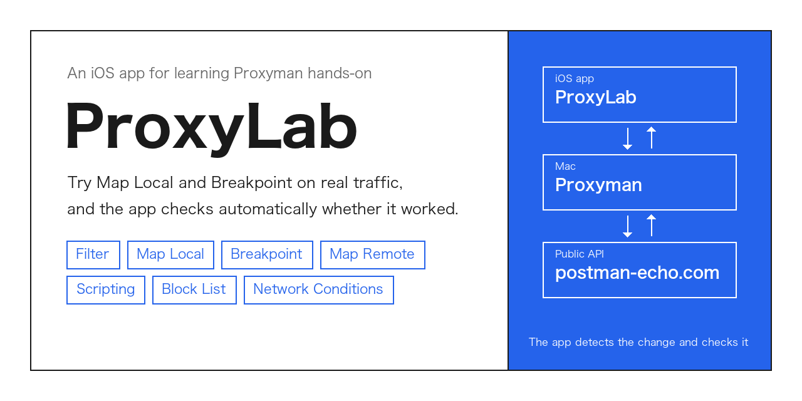
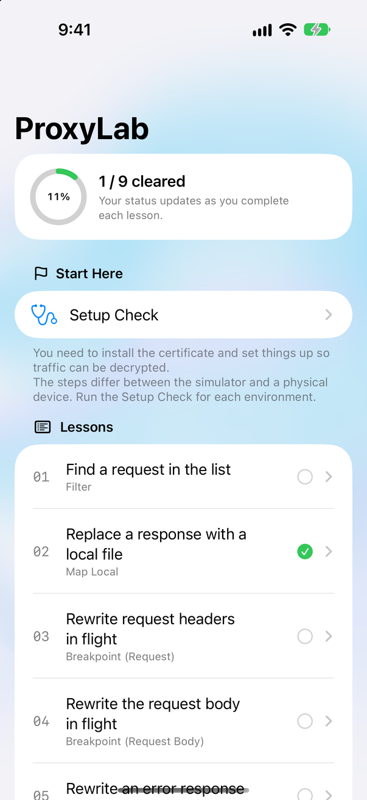
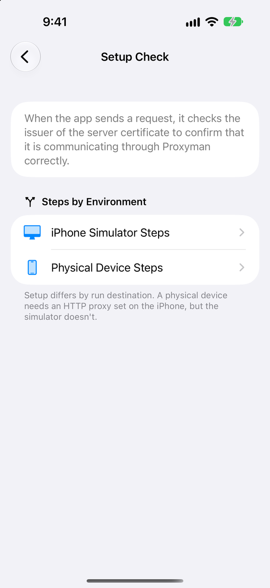
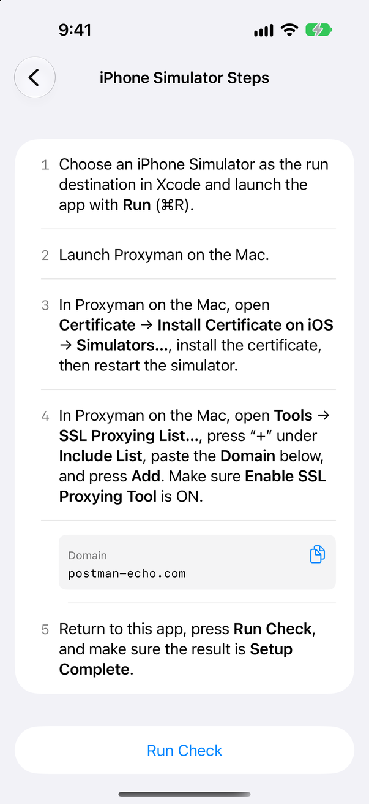
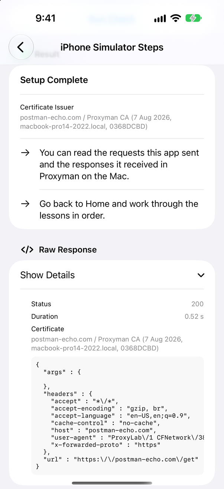
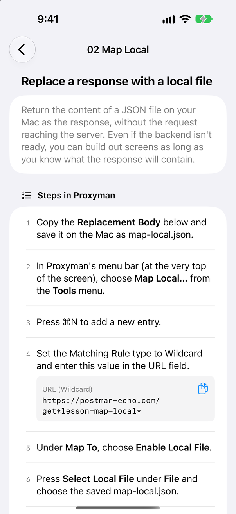
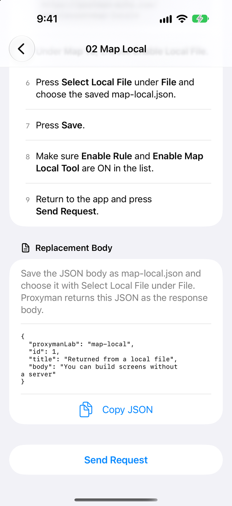
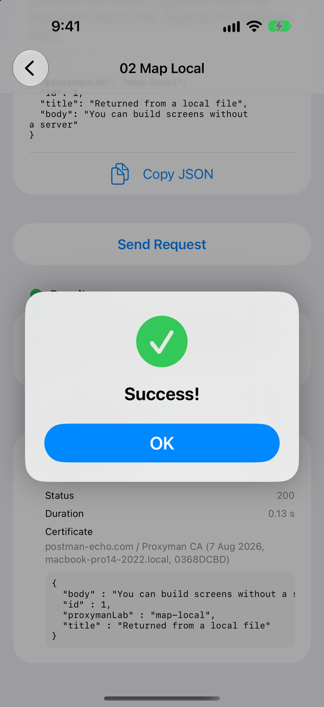

# ProxyLab

[日本語](README.md) | English



## What is ProxyLab?

ProxyLab is an iOS app for learning how to use Proxyman. Features such as Map Local and Breakpoint are hard to appreciate until you try them on real traffic. ProxyLab is the app you try them on.

```
┌───────────┐  HTTPS   ┌──────────┐  HTTPS   ┌──────────────────┐
│ ProxyLab  │ ───────► │ Proxyman │ ───────► │ postman-echo.com │
│  (iOS)    │          │  (Mac)   │          │   (public API)   │
└───────────┘          └──────────┘          └──────────────────┘
      ▲                      │
      │ detects the change   │ Map Local / Breakpoint /
      └──────────────────────┘ Scripting and so on
```

Each lesson is a pair: one request, and a verifier function that inspects the result. The only server is the public echo service postman-echo.com. Because it returns the headers and URL it received, the app can tell from the response alone whether the request was modified, so no backend is needed.

### When to use it

- You installed Proxyman but are not sure how to use Map Local or Breakpoint

  Each lesson lists the Proxyman steps in order, with copy buttons for every value you need to enter. Follow the steps, tap "Send Request", and the app tells you whether it worked.

- You want hands-on practice with workflows such as "build the UI before the server is ready" or "point a production build at staging"

  The Map Local, Map Remote, and Breakpoint lessons use these everyday situations as their material.

- You want to teach Proxyman to your team

  Working through the nine lessons in order covers the main features.

### Things to be aware of

- Running on a physical device

  You need to point the iPhone's Wi-Fi HTTP proxy at your Mac. On the simulator the Mac's settings apply, so this step is not needed.

- The verdicts depend on a public API

  If postman-echo.com is down, no lesson can be verified. The endpoint is defined in one place, `LabEndpoint.swift`, so you can swap in another echo service.

- Lesson 09 (slow network)

  The verdict compares against the time taken before throttling (the baseline). On an unstable connection the baseline fluctuates, so tap "Measure Baseline" a few times until the value settles.

### Who it is for

| Audience | What you get |
| --- | --- |
| iOS developers | How to see "the app in that state" by rewriting traffic, without touching the server or the code |
| QA and testers | How to reproduce error responses, partial API outages, and slow networks |
| New Proxyman users | Where and how to use the main features, from Filter to Scripting |

## Lessons

| # | Topic | Proxyman feature | What you learn |
| --- | --- | --- | --- |
| 01 | Find the request you want in the list | Filter | Narrow 12 similar requests down to one and read its contents |
| 02 | Replace a response with a local file | Map Local | Return a JSON file from your Mac before the request reaches the server |
| 03 | Edit a request header in flight | Breakpoint (Request) | Change headers such as an auth token mid-flight |
| 04 | Edit a request body in flight | Breakpoint (Request Body) | Change a value in a POSTed JSON body mid-flight |
| 05 | Rewrite an error response | Breakpoint (Response) | Turn the server's 500 into a 200 before it reaches the app |
| 06 | Redirect an API to another host | Map Remote | Forward production-bound requests to staging |
| 07 | Transform a response with JavaScript | Scripting | Insert an array into the response automatically |
| 08 | Block a specific API | Block List | Reproduce a state where only some APIs are down |
| 09 | Simulate a slow network | Network Conditions | Throttle just one request to 3G speed |

## Screens

### Home

The list of lessons and your progress. Completed lessons get a green check. Start with "Setup Check" to configure the certificate.



### Setup Check

The app makes a real request to check whether Proxyman can decrypt HTTPS. The steps differ between the simulator and a physical device, so both are provided.

<p>


</p>

Tap "Run Check" and the app inspects the server certificate's issuer to decide whether traffic is being decrypted through Proxyman. If the issuer is the Proxyman CA, it reports "Setup Complete". If something is missing, the app tells you what to do next.



### Lesson

Each lesson lists the steps to perform in Proxyman, numbered. Values to paste into Proxyman sit right under the step that uses them, with a copy button.

<p>


</p>

Tap "Send Request" and the app makes the request and checks the result. If Map Local is working, the JSON on your Mac comes back as-is and the lesson is cleared. If a step is still missing, the app shows what is missing along with the raw response it received.



## Getting started

### Requirements

| Item | Requirement |
| --- | --- |
| Mac | macOS with Proxyman |
| Toolchain | Xcode 16 or later (Swift 6) |
| Run destination | iOS 17 or later, simulator or device |

### Steps

1. Clone this repository and open `ProxyLab.xcodeproj` in Xcode
2. Choose an iPhone simulator as the run destination and run
3. Launch Proxyman on the Mac
4. Open "Setup Check" in the app and follow the on-screen steps to set up the certificate and the SSL Proxying List
5. Tap "Run Check" and confirm it reports "Setup Complete"
6. Work through the lessons starting from 01

### Running on a physical device

In the iPhone's Wi-Fi settings, set the HTTP proxy to your Mac's IP address and port (9090 by default), then install and trust the Proxyman certificate on the iPhone. The steps are in the app under "Setup Check" → "Physical Device Steps".

## Project layout

```
ProxyLab/
├── App/             Entry point
├── Core/
│   ├── Models/      Probe (the request to send), ProbeResult, Verdict
│   ├── Networking/  URLSession implementation, certificate inspection, system proxy lookup
│   ├── Persistence/ Saving lesson progress
│   └── Support/
├── Features/
│   ├── Home/          Home screen
│   ├── SetupDoctor/   Setup Check
│   ├── LessonDetail/  Lesson screen
│   └── Lab/           Screen state (LabModel)
├── Lessons/
│   ├── LessonCatalog.swift  Lesson definitions
│   ├── Verifiers.swift      One verifier function per lesson
│   └── LabMarkers.swift     Marker values used by the verifiers
└── Visual/            Aurora background (Metal shader)
ProxyLabTests/         Tests for verifiers and models (Swift Testing)
```

### Adding a lesson

1. Add a marker value to `LabMarkers.swift` (choose something the real server would never return)
2. Write one verifier function in `Verifiers.swift`
3. Append a `Lesson` to `all` in `LessonCatalog.swift`
4. Add a test for the verifier under `ProxyLabTests/`

## Resources

| Type | Resource |
| --- | --- |
| Proxyman | [Proxyman website (proxyman.com)](https://proxyman.com/) |
| Proxyman | [Proxyman documentation (docs.proxyman.com)](https://docs.proxyman.com/) |
| API used for verdicts | [Postman Echo (postman-echo.com)](https://postman-echo.com/) |

## License

[MIT License](LICENSE)
