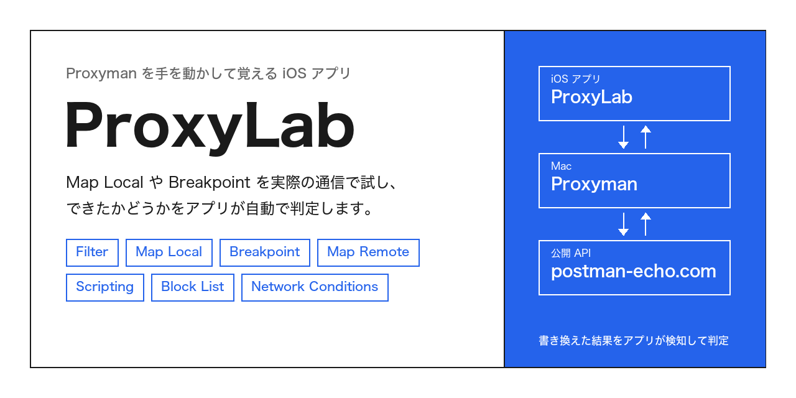
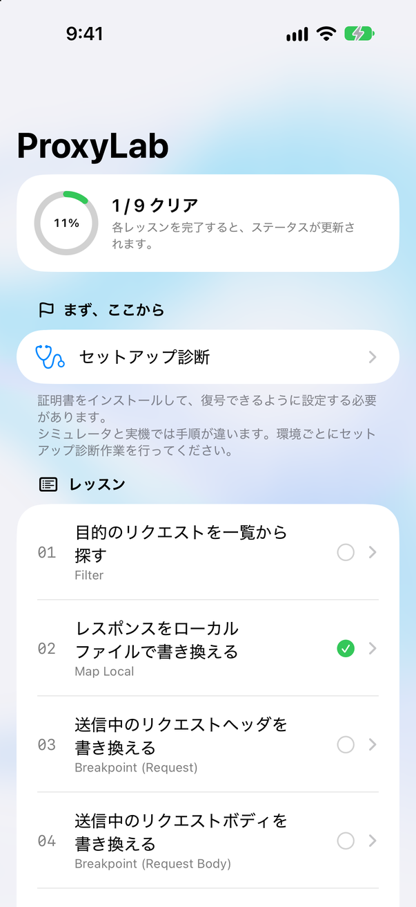
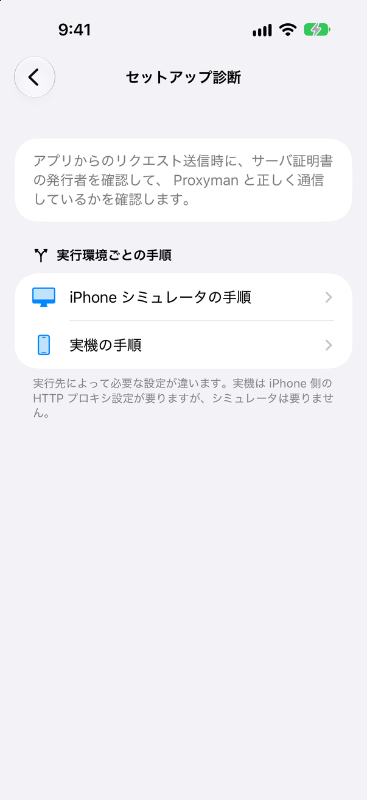
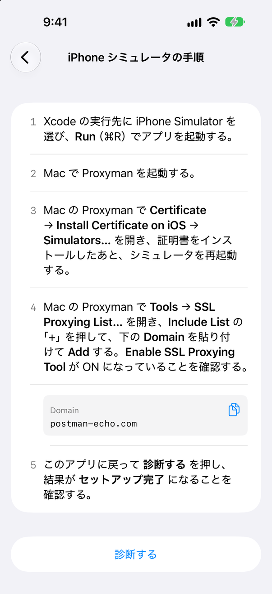
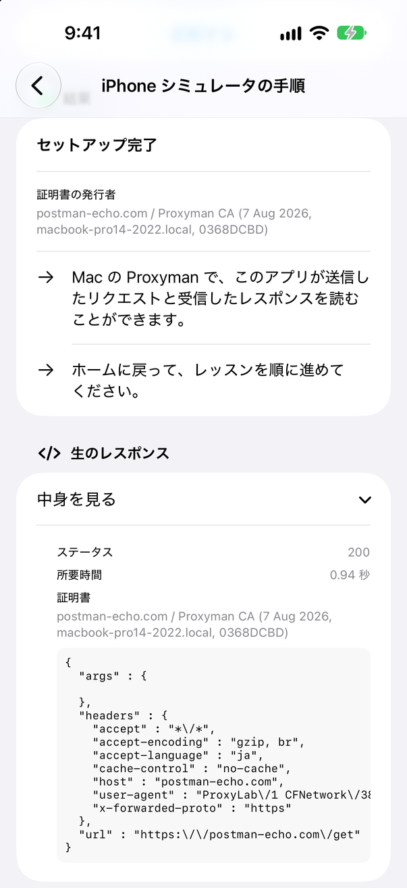
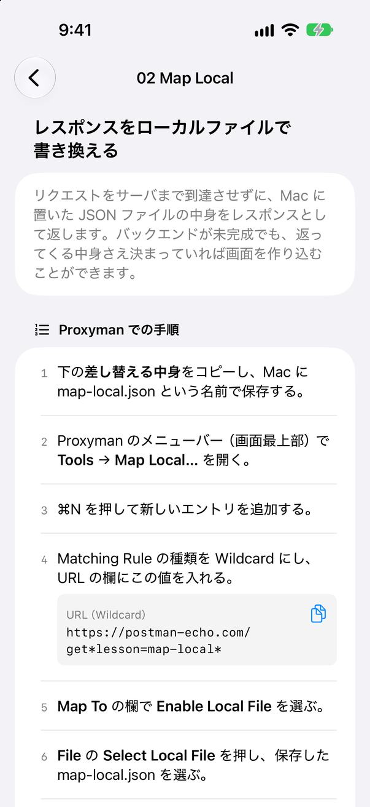
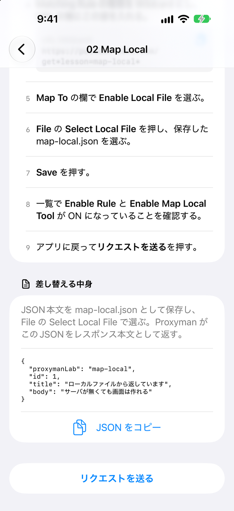
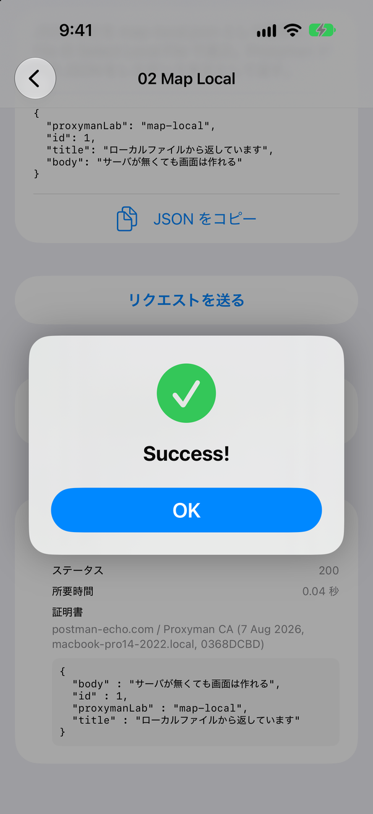

# ProxyLab

日本語 | [English](README.en.md)



## ProxyLab とは

ProxyLab は、Proxyman の使い方を学習するためのアプリです。 Proxyman の Map Local や Breakpoint といった機能は、実際の通信で試してみないと使いどころが分かりにくいものです。ProxyLab は、その「試す相手」になる iOS アプリです。

```
┌───────────┐  HTTPS   ┌──────────┐  HTTPS   ┌──────────────────┐
│ ProxyLab  │ ───────► │ Proxyman │ ───────► │ postman-echo.com │
│  (iOS)    │          │  (Mac)   │          │   (公開 API)      │
└───────────┘          └──────────┘          └──────────────────┘
      ▲                      │
      │ レスポンスの変化を検知    │ Map Local / Breakpoint /
      └──────────────────────┘ Scripting などを操作
```

各レッスンは「1 本のリクエスト」と「その結果を見る判定関数」の組です。サーバは公開のエコーサービス（postman-echo.com）だけを使います。受け取ったヘッダや URL をそのまま返すサービスなので、「リクエストを書き換えたかどうか」をレスポンスだけで判定でき、バックエンドを用意する必要がありません。

### こんなときに使う

- Proxyman を入れたものの、Map Local や Breakpoint をどう使えばよいか分からないとき

  レッスンごとに Proxyman 側の手順が番号付きで並び、入力する値はコピーボタン付きで用意してあります。手順どおりに操作して「リクエストを送る」を押せば、できたかどうかをアプリが判定します。

- 「サーバが未完成でも画面を作り込む」「本番ビルドのままステージングへ向ける」といった使い方を体で覚えたいとき

  Map Local、Map Remote、Breakpoint の各レッスンが、実務でよくある場面をそのまま題材にしています。

- チームに Proxyman の使い方を教えたいとき

  9 本のレッスンを順に進めるだけで、主要な機能を一通り触れます。

### 注意が必要なケース

- 実機で動かすとき

  iPhone の Wi-Fi 設定で HTTP プロキシを Mac に向ける必要があります。シミュレータなら Mac の設定がそのまま使われるので、この手順は要りません。

- 判定に公開 API を使っているとき

  postman-echo.com が落ちていると、どのレッスンも判定できません。エンドポイントは `LabEndpoint.swift` の 1 か所にまとめてあるので、別のエコーサービスへ差し替えられます。

- レッスン 09（低速回線）の判定

  絞る前の所要時間（baseline）との相対比較で判定します。回線が不安定だと baseline がぶれるので、「baseline を計測」を何度か押して安定した値を取ってください。

### 対象となる方

| 想定する方 | 得られること |
| --- | --- |
| iOS アプリ開発者 | 通信を書き換えて、サーバやコードを直さずに「その状態のアプリ」を見る方法 |
| QA・テスト担当者 | エラーレスポンス、一部の API 停止、低速回線といった異常系の再現方法 |
| Proxyman をこれから使う方 | Filter から Scripting まで、主要な機能の使いどころと操作手順 |

## レッスン一覧

| # | テーマ | Proxyman の機能 | 覚えること |
| --- | --- | --- | --- |
| 01 | 目的のリクエストを一覧から探す | Filter | 似たリクエスト 12 件の中から 1 件を絞り込み、中身を読む |
| 02 | レスポンスをローカルファイルで書き換える | Map Local | サーバに届く前に、Mac の JSON ファイルを返す |
| 03 | 送信中のリクエストヘッダを書き換える | Breakpoint (Request) | 認証トークンなどのヘッダを途中で書き換える |
| 04 | 送信中のリクエストボディを書き換える | Breakpoint (Request Body) | POST する JSON の値を途中で書き換える |
| 05 | エラーレスポンスを書き換えて返す | Breakpoint (Response) | サーバの 500 を 200 に書き換えてアプリに返す |
| 06 | API の向き先を切り替える | Map Remote | 本番向けのリクエストをステージングへ転送する |
| 07 | レスポンスを JavaScript で加工する | Scripting | レスポンスに配列を自動で差し込む |
| 08 | 特定の API をブロックする | Block List | 一部の API だけ落ちた状態を再現する |
| 09 | 低速回線を再現する | Network Conditions | 特定のリクエストだけ 3G 相当に絞る |

## 画面

### ホーム

レッスンの一覧と進捗です。クリアしたレッスンには緑のチェックが付きます。最初に「セットアップ診断」で証明書の設定を済ませます。



### セットアップ診断

Proxyman で HTTPS を復号できる状態になっているかを、アプリが実際に通信して確かめます。シミュレータと実機で手順が違うので、環境ごとの手順を用意しています。

<p>


</p>

「診断する」を押すと、サーバ証明書の発行者を見て、Proxyman を経由して復号できているかを判定します。証明書の発行者が Proxyman CA になっていれば「セットアップ完了」です。足りない設定があれば、次に何をすればよいかを表示します。



### レッスン

各レッスンには、Proxyman 側でやる手順が番号付きで並びます。Proxyman の入力欄に貼る値は、その値を使う手順のすぐ下にコピーボタン付きで置いてあります。

<p>


</p>

「リクエストを送る」を押すと、アプリが実際に通信して結果を判定します。Proxyman の Map Local が効いていれば、Mac に置いた JSON がそのまま返ってきてクリアになります。まだ操作が足りないときは、何が足りないかと、受け取った生のレスポンスを表示します。



## 始め方

### 必要なもの

| 種別 | 要件 |
| --- | --- |
| Mac | macOS と Proxyman |
| 開発環境 | Xcode 16 以降（Swift 6） |
| 実行先 | iOS 17 以降のシミュレータ、または実機 |

### 手順

1. このリポジトリをクローンし、`ProxyLab.xcodeproj` を Xcode で開く
2. 実行先に iPhone シミュレータを選んで Run する
3. Mac で Proxyman を起動する
4. アプリの「セットアップ診断」を開き、画面の手順に沿って証明書と SSL Proxying List を設定する
5. 「診断する」を押して「セットアップ完了」になったことを確認する
6. レッスン 01 から順に進める

### 実機で動かすとき

iPhone の Wi-Fi 設定で HTTP プロキシを Mac の IP アドレスとポート（既定は 9090）に向け、Proxyman の証明書を iPhone にインストールして信頼します。手順はアプリの「セットアップ診断」→「実機の手順」にあります。

## プロジェクトの構成

```
ProxyLab/
├── App/             エントリポイント
├── Core/
│   ├── Models/      Probe（送るリクエスト）、ProbeResult、Verdict（判定結果）
│   ├── Networking/  URLSession の実装、証明書の検査、システムプロキシの読み取り
│   ├── Persistence/ クリア状況の保存
│   └── Support/
├── Features/
│   ├── Home/          ホーム画面
│   ├── SetupDoctor/   セットアップ診断
│   ├── LessonDetail/  レッスン画面
│   └── Lab/           画面の状態（LabModel）
├── Lessons/
│   ├── LessonCatalog.swift  レッスンの定義
│   ├── Verifiers.swift      レッスンごとの判定関数
│   └── LabMarkers.swift     判定に使う目印の値
└── Visual/            背景のオーロラ（Metal シェーダ）
ProxyLabTests/         判定関数とモデルのテスト（Swift Testing）
```

### レッスンを足すには

1. `LabMarkers.swift` に、判定の目印にする値を足す（本物のサーバが絶対に返さない値にする）
2. `Verifiers.swift` に判定関数を 1 つ書く
3. `LessonCatalog.swift` の `all` に `Lesson` を 1 要素足す
4. `ProxyLabTests/` に判定関数のテストを足す

## 関連リソース

| 種別 | リソース |
| --- | --- |
| Proxyman | [Proxyman 公式サイト（proxyman.com）](https://proxyman.com/) |
| Proxyman | [Proxyman ドキュメント（docs.proxyman.com）](https://docs.proxyman.com/) |
| 判定に使う API | [Postman Echo（postman-echo.com）](https://postman-echo.com/) |

## ライセンス

[MIT License](LICENSE)
